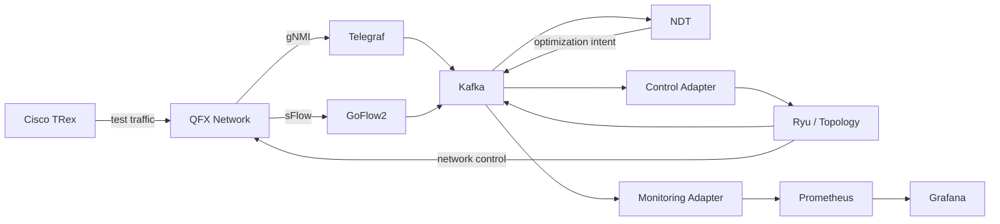

# NDT Master Thesis Knowledge Base

This vault is the central technical knowledge base for the master thesis project around a **Network Digital Twin (NDT)**, network telemetry, Kafka-based event distribution, monitoring, and closed-loop SDN control.

## Start here

1. [[01 - Project/Project Overview]]
2. [[01 - Project/Current Testbed Architecture]]
3. [[01 - Project/Target Kafka Hub Architecture]]
4. [[03 - Telemetry/Current Telemetry Pipelines]]
5. [[04 - Kafka/Kafka Overview]]
6. [[07 - NDT/NDT Fundamentals]]
7. [[09 - Thesis/Thesis Working Structure]]
8. [[10 - Reference/Glossary]]

## Mental model

## Four questions to ask for every component

- **What is it?** Product, protocol, data model, serialization format, database, controller, etc.
- **Where does it sit?** Producer, collector, broker, consumer, storage, visualization, control plane.
- **What goes in and what comes out?** Protocol, payload, schema, timestamps, IDs.
- **Why is it relevant to NDT synchronization?** Freshness, reliability, consistency, replay, scalability, overhead, closed-loop safety.

## Status labels used in this vault

- **Known** — directly provided for the project/testbed.
- **Planned** — target architecture idea for the thesis.
- **TBD** — must be verified in configuration or with the team.
- **General** — technical background, not a claim that the project uses it exactly this way.

See [[10 - Reference/Open Questions and Verification Checklist]].
