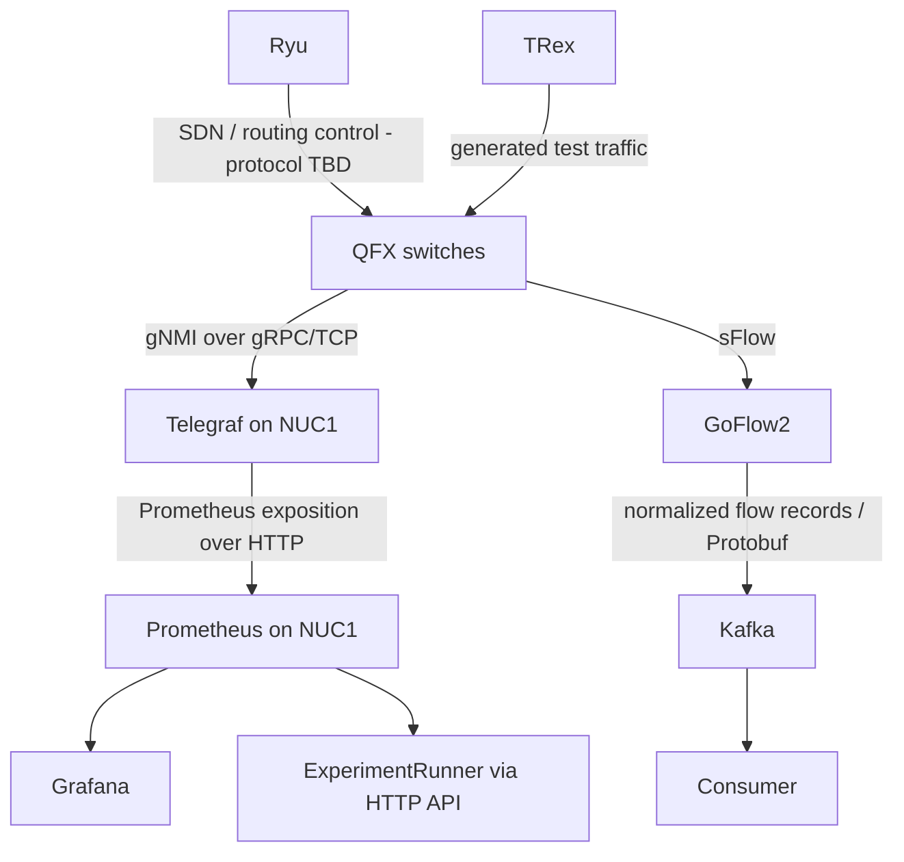

# Current Testbed Architecture

## Physical topology

![[Assets/testbed-network-architecture.png]]

The supplied architecture diagram shows a QFX fabric with:

- orange management links,
- red 10 GbE inter-switch links,
- blue 100 GbE links toward traffic-generator systems.

## Management network

`172.20.202.*` — main-campus management network.

| Device |    Management IP | Role              |
| ------ | ---------------: | ----------------- |
| NUC1   |  `172.20.202.41` | Orchestrator      |
| NUC2   |  `172.20.202.42` | Traffic Generator |
| NUC3   |  `172.20.202.43` | Traffic Generator |
| NUC4   |  `172.20.202.44` | Traffic Generator |
| NUC5   |  `172.20.202.45` | Traffic Generator |
| SW01   | `172.20.202.151` | Juniper QFX       |
| SW02   | `172.20.202.152` | Juniper QFX       |
| SW03   | `172.20.202.153` | Juniper QFX       |
| SW04   | `172.20.202.154` | Juniper QFX       |
| SW05   | `172.20.202.155` | Juniper QFX       |
| SW06   | `172.20.202.156` | Juniper QFX       |
| SW07   | `172.20.202.157` | Juniper QFX       |
| SW08   | `172.20.202.158` | Juniper QFX       |

| User Nucs:     | Ubuntu   |
| ----------------- | -------- |
| **User Switche:** | **Root** |

User NUCs run Ubuntu. User switches are accessible with root-level access according to the project notes.

## Data network

`172.20.2.*` — main-campus data network.

This is conceptually separate from the management network. The exact data-plane IP assignment should be documented from the real configuration.

## Current logical paths

## Important architectural observation

The testbed separates **management/telemetry/control traffic** from much of the high-rate data-plane experiment traffic. This may make synchronization quality look better than in a deployment where telemetry and production traffic compete for the same links. This distinction belongs directly in the evaluation and discussion chapters.

See [[02 - Network Fundamentals/Management Control Data and Telemetry Planes]].
