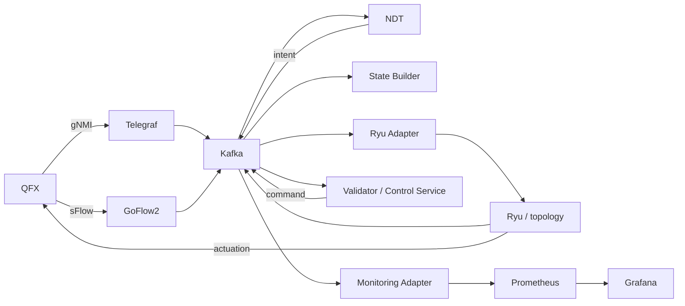

# Target Kafka Hub Architecture

## Goal

Kafka is intended to become a central, durable event backbone for the state exchanged between the physical network, the NDT, monitoring, and the SDN control path.

## Design principles

1. **Separate semantics, not devices, into topics.** Avoid one topic per switch/metric.
2. **Use keys for ordering/locality.** Examples: `device_id`, `device|interface`, `flow_hash`.
3. **Separate event history from current state.** Event topics support replay; compacted state topics support fast bootstrap.
4. **Separate telemetry from control.** A control command must never share a high-volume telemetry topic.
5. **Use correlation IDs for closed-loop commands and results.**
6. **Preserve source timestamps.** Kafka arrival time alone is not enough to measure NDT freshness.
7. **Define an internal canonical schema.** The NDT should not need to understand raw vendor/gNMI/sFlow formats everywhere.
8. **Keep observability of the hub itself.** Consumer lag, broker latency, dropped/failed records and state age are NDT-health inputs.

See [[04 - Kafka/Topic Architecture Proposal]] and [[04 - Kafka/Closed Loop Messaging]].
