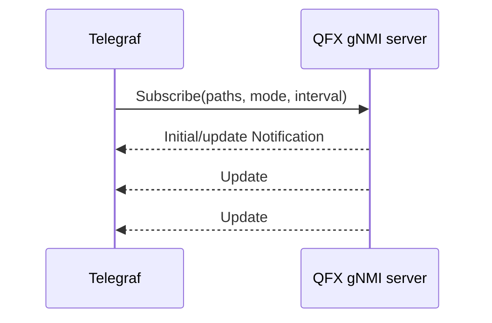

# gNMI

**gNMI = gRPC Network Management Interface.** It is a gRPC-based interface for retrieving state, modifying configuration, and subscribing to network telemetry.

## Main RPCs

- `Capabilities` — discover supported models/encodings/capabilities.
- `Get` — retrieve a snapshot of data.
- `Set` — change configuration/state where supported/allowed.
- `Subscribe` — stream state updates.

## Project use

The known pipeline uses gNMI primarily for **streaming telemetry** from QFX switches to Telegraf.



## Subscription modes

Common concepts include:
- `sample` — send values at a configured interval,
- `on_change` — send when value changes,
- `target_defined` — device determines suitable behavior.

Exact support depends on device/model/path.

## Protocol stack

```text
gNMI
  ↓
gRPC
  ↓
HTTP/2
  ↓
TCP
  ↓
IP
  ↓
Ethernet
```

The gNMI API messages are defined in Protobuf. Values inside updates can use negotiated encodings such as `proto`, `json`, `json_ietf`, or `bytes` depending on implementation/client configuration.

## Thesis relevance

- source of high-frequency physical state,
- timestamp quality,
- sample/on-change behavior,
- reconnect behavior and gaps,
- path selection and data volume,
- transformation into Kafka event schemas.

## Sources

- OpenConfig RPC explorer: https://openconfig.net/rpc/
- OpenConfig documentation: https://openconfig.net/docs/
- Telegraf gNMI input: https://docs.influxdata.com/telegraf/v1/input-plugins/gnmi/
