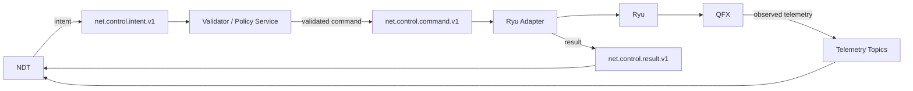

# Closed Loop Messaging

## Recommended flow

## Intent vs command

**Intent** expresses desired outcome at higher level.

Example: "Move traffic demand X away from congested path."

**Command** is validated and concrete enough for a control adapter.

Example: "Install/update this specific forwarding rule on target SW04."

## Correlation

Every intent/command should carry:
- `intent_id`,
- `command_id`,
- target,
- creation time,
- expiry/deadline,
- desired state/version,
- experiment/run ID where relevant.

Results reference `command_id`.

## Status model

Useful statuses:
- `RECEIVED`
- `VALIDATED`
- `REJECTED`
- `SENT_TO_CONTROLLER`
- `ACCEPTED`
- `FAILED`
- `OBSERVED_EFFECT` (derived after telemetry confirms result)

## Safety principle

The NDT should not directly push arbitrary raw actions into the physical network without validation, authorization, idempotency checks, expiry handling, and observability.
